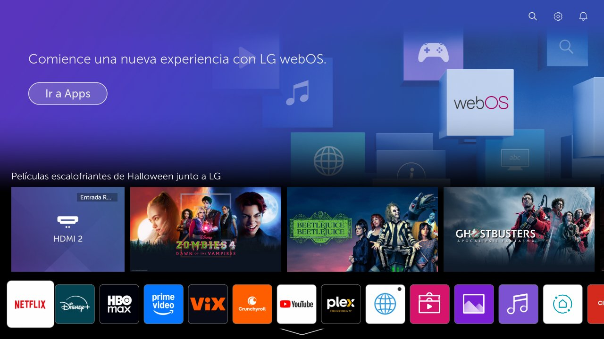
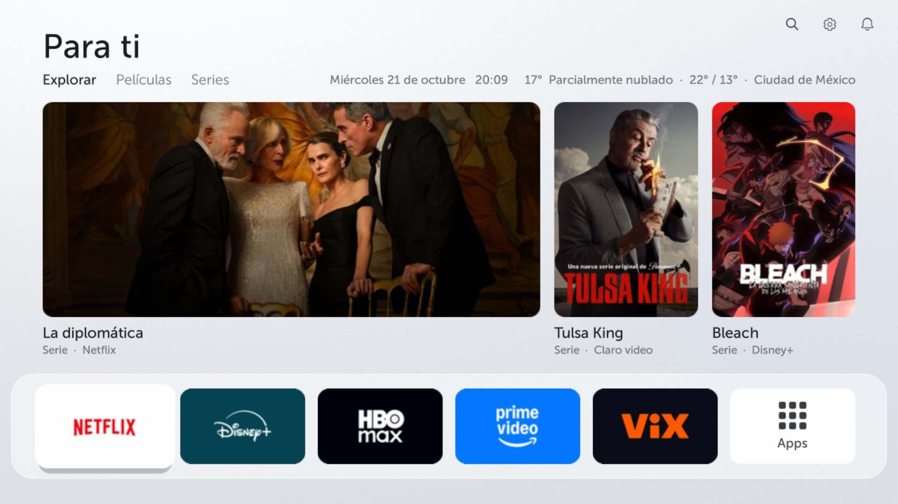
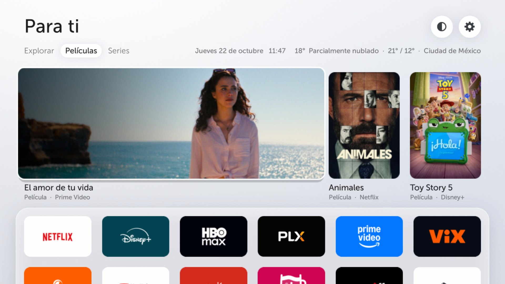
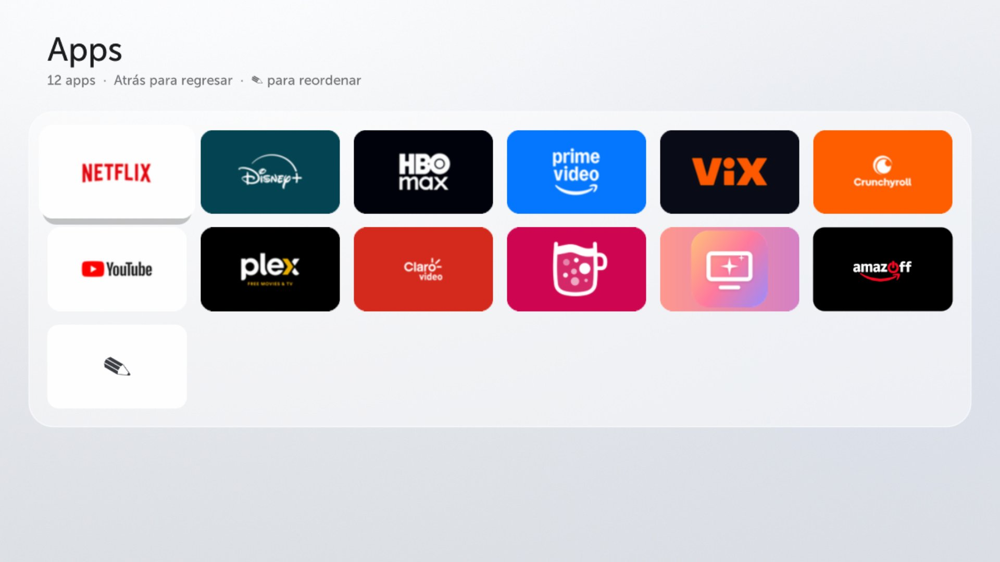

<div align="center">

# LGlow

**Your old LG TV needs a glow up.** A clean, fast, ad-free home screen for 2019 LG TVs on webOS 4.5,
built on top of the stock one.

[Website](https://irvingguerra.github.io/lglow/) · [Español](README.md) · [Before and after](#before-and-after) · [vs Free My TV](#what-about-free-my-tv) · [Compatibility](#compatibility) · [Install](#install)

</div>

> [!WARNING]
> This requires a **rooted TV**. Use at your own risk. Everything in this repo is reversible and **never writes
> to LG's read-only partitions**, but mistakes in other rooting steps (not this project) can brick a TV.

The detailed guides are in Spanish (`docs/`). Commands and file paths are the same in any language.

## Before and after

| Before (stock LG home) | After |
| --- | --- |
|  |  |

| Movies / Shows tabs | All apps screen |
| --- | --- |
|  |  |

## What you get

- **No LG ads on the home screen:** no banner, no sponsored content rows, no screensaver ads.
- **"Para ti" (For you):** three trending titles every hour, **only from apps you have** ([TMDB](https://www.themoviedb.org)),
  with Explore / Movies / Shows tabs. OK opens the app that has it.
- **Weather, date and time** for your city ([Open-Meteo](https://open-meteo.com), no key needed).
- **Big rectangular app tiles** in each brand's color, **one row** of 5 pinned apps, and an **Apps** screen with
  the rest.
- **Hide apps** you don't use, without uninstalling them.
- **More free memory:** the old launcher bar stops running and LG stops preloading Netflix/YouTube/Prime.
  On the test TV, free RAM at idle went from ~106 MB to ~160–250 MB and swap in use from ~265 MB to ~30 MB.
- **Root protection:** disables a Developer Mode trap that **wipes Homebrew Channel and root** on reboot when
  the LG Developer Mode app is still installed ([details](docs/02-trampa-developer-mode.md)).

## What about Free My TV?

[Free My TV](https://github.com/simbasjungles/free-my-tv) inspired LGlow's design, and on LG it's a great choice
**if you don't want to root**. But it works differently:

| | Free My TV on LG | LGlow |
| --- | --- | --- |
| What it is | **Another app** (a launcher), installed through Developer Mode | **Replaces the system's own home**: the one the Home button opens |
| LG's home | Stays as it is, ads included. Free My TV opens with a number key | **Gone**: the Home button opens the new one directly |
| Root | Not needed | Required (faultmanager + Homebrew Channel) |
| Developer Mode | Must be renewed every ~40 days or the app is removed | Not used. It also disables the trap that wipes root |
| Beyond the home | — | Hides system apps, turns off preloads and ads, frees RAM, blocks the updates that remove root |
| TVs | webOS 3+, Google TV, Samsung | LG webOS 4.5, 2019 models |

In short: **Free My TV is an app you open on top of your TV; LGlow changes the TV at the root.** If your TV is
already rooted (or you're willing to root it), LGlow actually gets rid of LG's home.

## Compatibility

- **Tested on:** LG 43LM5770PUA (2019), webOS 4.10.2 (Rockhopper 4.10.2-29), firmware 05.40.97.
- **Should work on:** the whole 2019 lineup (webOS 4.5) with the **full-screen home** (`com.webos.app.fullhome`)
  that LG rolled out in December 2023 with firmware **05.40.09**: B9 and UM/SM/LM LCDs first, then C9 and E9.
  The test TV is a "webOS TV Lite" model; higher-end models may ship slightly different files. The installer
  **checks the md5 of every file it patches** and stops without changing anything if they don't match.
- **Requires:** root via [faultmanager-autoroot](https://github.com/throwaway96/faultmanager-autoroot) +
  [Homebrew Channel](https://github.com/webosbrew/webos-homebrew-channel), and SSH root access.
- **Not for:** 2018 (webOS 4.0), which is rootable but never got the full-screen home, and 2025 (webOS 10),
  whose home is Flutter: see [mareklarek/webos10-homescreen-customization](https://github.com/mareklarek/webos10-homescreen-customization).
- **Portable:** 2020–2024 (webOS 5 to 9) also have a QML home, so the technique carries over with new patches,
  but the latest firmware on those TVs blocks the root exploit.

What matters isn't the year but how the home is built: LGlow patches the QML home of webOS 4.5.

## Install

### With your AI

If you'd rather have an AI (ChatGPT, Claude, Gemini…) guide you, fill in your TV's details and paste this:

```text
I want to install LGlow (https://github.com/IrvingGuerra/lglow) on my LG TV. Be my step-by-step guide.

My TV:
- Model: [e.g. 43LM5770PUA, on the sticker or in Settings → General → About this TV]
- webOS TV version: [e.g. 4.10.2]
- Software version: [e.g. 05.40.97]
- My computer: [macOS / Windows / Linux]

How to help me:
1. Read the repo's README and the guides in docs/ first (they're in Spanish, translate them for me). Use them as the source of truth, not your memory.
2. Check compatibility before anything else. LGlow is made for 2019 LG TVs on webOS 4.5 with the full-screen home (com.webos.app.fullhome, firmware 05.40.09 or newer). Tell me honestly if my TV fits, and have me check root status on https://cani.rootmy.tv.
3. Walk me through the guides in order: 01 root, 02 Developer Mode trap, 03 SSH and update blocking, 04 install, 06 optional cleanup. One step at a time: wait for me to confirm or paste the output before moving on.
4. Explain what each command does before I run it, and warn me clearly before anything risky.
5. Never suggest writing to LG's read-only partitions, never tell me to open, reinstall or update LG's Developer Mode app, and don't update the TV's firmware.
6. If the installer says the files don't match my firmware, don't force it: help me port the patches following docs/05-como-funciona.md ("Regenerar los parches para otro firmware").
7. If something goes wrong, the way back is ./instalar.sh <TV IP> --quitar and a reboot (docs/07-problemas-y-desinstalar.md).
```

### Already rooted with SSH

```bash
git clone https://github.com/IrvingGuerra/lglow && cd lglow
./instalar.sh 192.168.1.50                 # your TV's IP
ssh root@192.168.1.50 vi /var/lib/webosbrew/fullhomecustom/config.json   # TMDB key, city, coordinates
python3 tools/make-tiles.py 192.168.1.50   # rectangular tiles from your TV's app icons
```

Uninstall: `./instalar.sh 192.168.1.50 --quitar`, then reboot the TV.

If you're outside Mexico, add your country's TMDB provider ids to `config.json`
(see [docs/04-instalar-home.md](docs/04-instalar-home.md#otros-países)). UI text is in Spanish.

## How it works (short version)

- The installer copies the stock QML from your TV to `/var/lib/webosbrew`, applies the patches in
  `tv/patches/` and adds three new components (`tv/qml/`). **No LG code is distributed.**
- A boot script (`init.d/10-homecustom`) `mount --bind`s the patched copy over the original.
- **The CRIU trick:** on webOS 4 the home is *restored* from a factory CRIU image that already holds the stock
  QML in memory. The script covers `/tmp/checkpoint/<app>` and `/mnt/lg/cmn_data/checkpoint/<app>` with an
  empty folder so the home cold-starts and reads the mounted QML.
- Root starts ~42 s after power-on, so the stock design is visible for the first ~45 s after a full boot.

Full technical notes: [docs/05-como-funciona.md](docs/05-como-funciona.md).

## Credits

[faultmanager-autoroot](https://github.com/throwaway96/faultmanager-autoroot),
[Homebrew Channel / webosbrew](https://www.webosbrew.org),
[webos10-homescreen-customization](https://github.com/mareklarek/webos10-homescreen-customization) (the
bind-mount idea), [Free My TV](https://github.com/simbasjungles/free-my-tv) (the design),
[TMDB](https://www.themoviedb.org) (this product uses the TMDB API but is not endorsed or certified by TMDB)
and [Open-Meteo](https://open-meteo.com).

## License

MIT for everything in this repo. LG's home screen code is not included. Not affiliated with LG.
