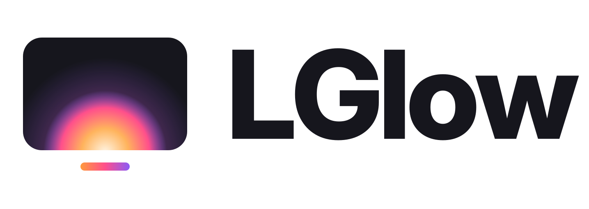
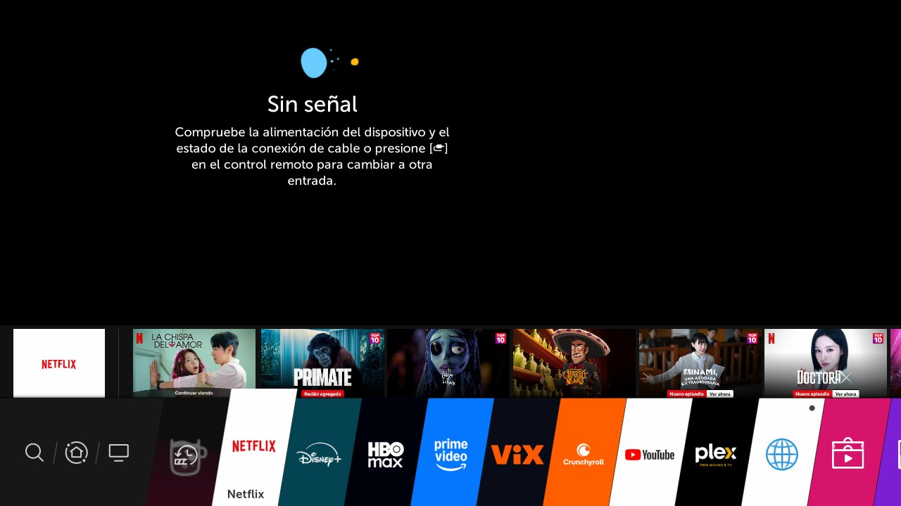
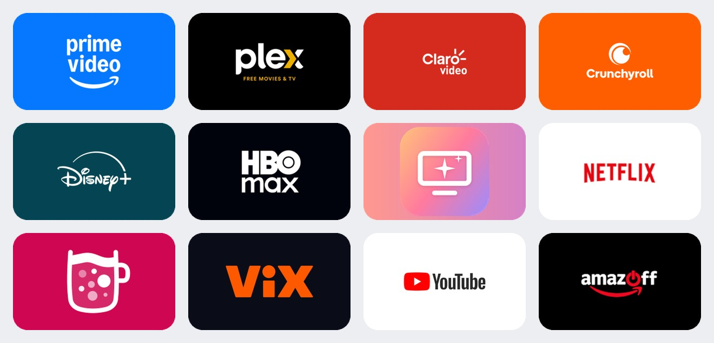
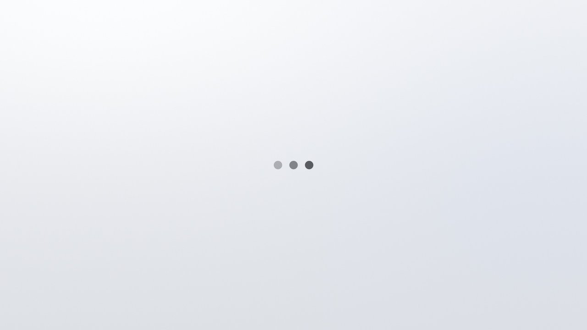

<div align="center">

<h1><a href="https://irvingguerra.github.io/lglow/es/"><picture><source media="(prefers-color-scheme: dark)" srcset="docs/img/marca/lglow-logo-oscuro.svg"></picture></a></h1>

**¿Tu vieja LG necesita un glow up?** Un home limpio, rápido y sin publicidad para TVs LG de 2019 con
webOS 4.5, hecho sobre el home original.

Tendencias de tus propias apps, el clima, tiles grandes y nada de banners de LG.
Sin tocar las particiones del sistema: todo se monta encima y se quita con un comando.

[Sitio web](https://irvingguerra.github.io/lglow/es/) · [Antes y después](#antes-y-después) · [vs Free My TV](#y-free-my-tv) · [Compatibilidad](#compatibilidad) · [Guía paso a paso](#guía-paso-a-paso) · [Cómo funciona](docs/05-como-funciona.md) · [Problemas](docs/07-problemas-y-desinstalar.md) · [English](README.en.md) ([guides](docs/en/01-root.md))

</div>

> [!WARNING]
> Esto requiere **rootear la TV**. Hazlo bajo tu propio riesgo. Todo lo de este repo es reversible y
> **nunca escribe en las particiones de solo lectura de LG**, pero un error en otros pasos del root (no
> en este proyecto) puede dejar la TV inservible. Lee la guía completa antes de empezar.

## Antes y después

| Antes (home de LG) | Después |
| --- | --- |
|  |  |
| Banner de LG, "Ir a Apps", fila de contenido promocionado, íconos chicos y todas las apps de sistema. | "Para ti" con lo que está en tendencia **en tus apps**, fecha, hora y clima, y tus 5 apps fijadas. |

| Películas / Series | Todas las apps |
| --- | --- |
|  |  |
| Pestañas **Explorar · Películas · Series**. OK en un título abre la app donde está. | Abajo de tu fila se asoma el resto: **↓ hace scroll** a todas tus apps. Atrás regresa. |

<details>
<summary>Más capturas: la barra vieja, los tiles y la pantalla de carga</summary>

| La barra vieja de webOS 4.5 (también se limpia) | Tiles generados desde los íconos de tu TV |
| --- | --- |
|  |  |

| Pantalla de carga genérica de LG | La nueva |
| --- | --- |
|  |  |

</details>

## Qué obtienes

- **Sin publicidad de LG en el home:** fuera el banner, la fila de recomendaciones patrocinadas, los anuncios
  del protector de pantalla y la cookie publicitaria.
- **"Para ti":** cada hora, tres títulos en tendencia de esta semana, **solo de las apps que tienes** (datos de
  [TMDB](https://www.themoviedb.org)). Pestañas de Explorar, Películas y Series. OK en uno abre su app.
- **Clima, fecha y hora** de tu ciudad ([Open-Meteo](https://open-meteo.com), sin llave).
- **Apps grandes y rectangulares** con el color de cada marca, en **una sola fila** con tus 6 favoritas. Abajo se
  asoma el resto y **↓ hace scroll** hasta todas tus apps.
- **Modo claro, oscuro o automático** (claro de día y oscuro de noche, con el amanecer y el atardecer de tu
  ciudad), desde el botón de tema de arriba. Al lado, el **engranaje** abre el **panel rápido de LGlow**: modo de imagen y de sonido,
  apagado automático, tema, entradas (TV, HDMI) y un acceso a todos los ajustes de la TV, sin submenús.
- **Oculta las apps que no usas** (navegador, tienda, música…) sin desinstalarlas.
- **Más memoria libre:** la barra vieja deja de ocupar RAM y LG ya no precarga Netflix, YouTube ni Prime en
  segundo plano. En la TV de prueba, la RAM disponible en reposo pasó de **~106 MB a ~160–250 MB** y el swap
  en uso, de **~265 MB a ~30 MB**.
- **Root blindado:** se desactiva una trampa de la app Developer Mode que **borra el root** (y Homebrew
  Channel) en un reinicio. [Ver por qué](docs/02-trampa-developer-mode.md).

## ¿Y Free My TV?

[Free My TV](https://github.com/simbasjungles/free-my-tv) inspiró el diseño de LGlow, y en LG es una gran opción
**si no quieres rootear**. Pero funciona distinto:

| | Free My TV en LG | LGlow |
| --- | --- | --- |
| Qué es | **Una app más** (launcher) que se instala con Developer Mode | **Cambia el home del propio sistema**: el que abre el botón Home |
| El home de LG | Se queda igual, con su publicidad. Free My TV se abre con una tecla numérica | **Desaparece**: el botón Home abre directamente el nuevo |
| Root | No hace falta | Sí (faultmanager + Homebrew Channel) |
| Developer Mode | Hay que renovarlo cada ~40 días, o la app se borra | No se usa. Además desactiva la trampa que borra el root |
| Más allá del home | — | Oculta apps de sistema, apaga precargas y publicidad, libera RAM y bloquea las actualizaciones que quitan el root |
| TVs | webOS 3 o más nuevo, Google TV, Samsung | LG webOS 4.5, modelos de 2019 |

En corto: **Free My TV es una app que abres encima de la TV; LGlow cambia la TV desde la raíz.** Si tu TV ya está
rooteada (o estás dispuesto a rootearla), LGlow te quita el home de LG de verdad.

## Compatibilidad

| | |
| --- | --- |
| **Probado en** | LG **43LM5770PUA** (2019), webOS **4.10.2** (Rockhopper `4.10.2-29`), firmware **05.40.97** |
| **Debería funcionar en** | Toda la línea 2019 (webOS 4.5) con el **home de pantalla completa** (`com.webos.app.fullhome`), que LG mandó en diciembre de 2023 con el firmware **05.40.09**: primero B9 y las LCD UM/SM/LM, luego C9 y E9. La TV de prueba es "webOS TV Lite"; los modelos de gama alta pueden traer archivos un poco distintos. El instalador **revisa la versión de cada archivo** y no toca nada si no coincide. |
| **Requiere** | Root con [faultmanager-autoroot](https://github.com/throwaway96/faultmanager-autoroot) + [Homebrew Channel](https://github.com/webosbrew/webos-homebrew-channel), y una computadora con `ssh` en la misma red. Para "Para ti": una llave gratis de [TMDB](https://www.themoviedb.org/settings/api). |
| **No sirve para** | 2018 (webOS 4.0): se puede rootear, pero no recibió el home de pantalla completa. 2025 (webOS 10): el home es Flutter; ve [mareklarek/webos10-homescreen-customization](https://github.com/mareklarek/webos10-homescreen-customization). |
| **Portable** | 2020–2024 (webOS 5 a 9): el home también es QML, así que la técnica sirve con parches nuevos. Pero el firmware más reciente de esas TVs ya bloquea el exploit de root. |

Lo que importa no es el año, sino cómo está hecho el home: LGlow parcha el home en QML de webOS 4.5.

¿Tu modelo es otro de 2019? Si el instalador dice que los archivos no coinciden, abre un issue con la
salida de `md5sum` y tu versión de firmware. Los parches se pueden regenerar
(ver [docs/05-como-funciona.md](docs/05-como-funciona.md#regenerar-los-parches-para-otro-firmware)).

## Guía paso a paso

1. **[Rootear la TV](docs/01-rootear.md):** faultmanager-autoroot + Homebrew Channel.
2. **[Desactivar la trampa de Developer Mode](docs/02-trampa-developer-mode.md):** obligatorio si la app
   Developer Mode de LG sigue instalada. Sin esto, un reinicio puede borrar el root.
3. **[Acceso por SSH y bloqueo de actualizaciones](docs/03-acceso-y-actualizaciones.md):** para que LG no
   quite el root con una actualización.
4. **[Instalar el home renovado](docs/04-instalar-home.md):** un comando desde tu computadora.
5. **[Limpieza y memoria](docs/06-limpieza-y-memoria.md):** opcional. Apaga publicidad y precargas.

### Con ayuda de tu IA

Si prefieres que una IA (ChatGPT, Claude, Gemini…) te guíe, llena los datos de tu TV y pégale esto:

```text
Quiero instalar LGlow (https://github.com/IrvingGuerra/lglow) en mi TV LG. Sé mi guía paso a paso.

Mi TV:
- Modelo: [p. ej. 43LM5770PUA, viene en la etiqueta o en Configuración → General → Acerca de esta TV]
- Versión de webOS TV: [p. ej. 4.10.2]
- Versión de software: [p. ej. 05.40.97]
- Mi computadora: [macOS / Windows / Linux]

Cómo ayudarme:
1. Primero lee el README del repo y las guías de docs/. Úsalas como fuente de verdad, no tu memoria.
2. Antes que nada, revisa la compatibilidad. LGlow es para TVs LG de 2019 con webOS 4.5 y el home de pantalla completa (com.webos.app.fullhome, firmware 05.40.09 o más nuevo). Dime con honestidad si mi TV entra, y pídeme revisar en https://cani.rootmy.tv si se puede rootear.
3. Llévame por las guías en orden: 01 root, 02 trampa de Developer Mode, 03 SSH y bloqueo de actualizaciones, 04 instalar, 06 limpieza opcional. Un paso a la vez: espera a que confirme o pegue la salida antes de seguir.
4. Explícame qué hace cada comando antes de correrlo y avísame con claridad antes de cualquier cosa riesgosa.
5. Nunca sugieras escribir en las particiones de solo lectura de LG, nunca me digas que abra, reinstale o actualice la app Developer Mode de LG, y no actualices el firmware de la TV.
6. Si el instalador dice que los archivos no coinciden con mi firmware, no lo fuerces: ayúdame a portar los parches con docs/05-como-funciona.md ("Regenerar los parches para otro firmware").
7. Si algo sale mal, para regresar todo está ./instalar.sh <IP de la TV> --quitar y reiniciar (docs/07-problemas-y-desinstalar.md).
```

### Resumen para quien ya tiene root y SSH


```bash
git clone https://github.com/IrvingGuerra/lglow && cd lglow
./instalar.sh 192.168.1.50                 # la IP de tu TV
ssh root@192.168.1.50 vi /var/lib/webosbrew/fullhomecustom/config.json   # llave TMDB y ciudad
python3 tools/make-tiles.py 192.168.1.50   # tiles rectangulares de tus apps
```

Para quitarlo todo: `./instalar.sh 192.168.1.50 --quitar` y reiniciar la TV.

## Uso

| En el home | |
| --- | --- |
| **← →** | Moverse entre apps, títulos o pestañas |
| **↑ ↓** | Botones de arriba ↔ pestañas ↔ títulos ↔ apps. **↓ desde la fila** hace scroll a todas las apps |
| **OK** | Abrir la app o el título (abre la app donde está) |
| **Atrás** (o ↑ desde la primera fila) | En todas las apps, regresa al home |
| **Lápiz (✎)** al final de todas las apps | Modo edición de LG: las **6 primeras** son las fijadas del home |

## Limitaciones conocidas

- **Los primeros ~45 s después de prender la TV** se ve el diseño de LG. En webOS 4 no hay forma de correr
  código antes de que arranque el root. Si presionas Home en ese lapso, el home cambia solo al nuevo en cuanto
  el script corre. Con **Quick Start+** encendido la TV se suspende en vez de apagarse, y el diseño se conserva
  entre encendidos.
- **La pantalla de carga genérica** a veces sigue siendo la de LG. El compositor de webOS vuelve desde un
  snapshot de fábrica en cada arranque, con esa imagen ya en caché. Cambiarla de verdad requeriría modificar el
  compositor, y no vale el riesgo. Las apps con splash propio (Netflix, Disney+, Max…) muestran el suyo.
- **La velocidad al abrir o cambiar de app** mejora poco: la TV tiene 674 MB de RAM y las apps de streaming
  son web apps pesadas. Ver [mediciones](docs/06-limpieza-y-memoria.md#qué-tanto-mejora-la-velocidad).
- Textos en español. Los ids de proveedores de "Para ti" vienen para México; para otro país,
  [cámbialos en config.json](docs/04-instalar-home.md#otros-países).

## Créditos

- [faultmanager-autoroot](https://github.com/throwaway96/faultmanager-autoroot) (throwaway96, buglloc) y
  [Homebrew Channel](https://github.com/webosbrew/webos-homebrew-channel) / [webosbrew.org](https://www.webosbrew.org):
  el root y el arranque de scripts.
- [mareklarek/webos10-homescreen-customization](https://github.com/mareklarek/webos10-homescreen-customization):
  la idea de montar una copia modificada del home encima del original.
- [Free My TV](https://github.com/simbasjungles/free-my-tv): el diseño de la pantalla de inicio.
- Datos: [TMDB](https://www.themoviedb.org) (este producto usa la API de TMDB, pero TMDB no lo respalda ni
  certifica) y [Open-Meteo](https://open-meteo.com).

## Licencia

El código de este repo (scripts, parches, componentes QML nuevos y herramientas) está bajo [MIT](LICENSE).
**El código del home de LG no está incluido:** el instalador lo copia de tu propia TV y le aplica los parches.
LG, webOS y los nombres y logos de las apps son marcas de sus dueños. Este proyecto no está afiliado con LG.
